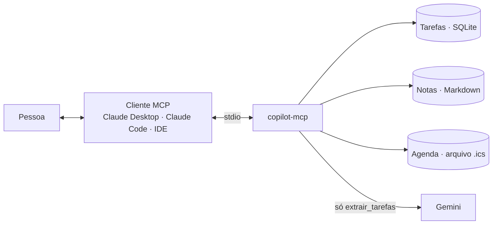

# 🗓️ AI Productivity Copilot: tarefas, notas e agenda via MCP

**Um servidor MCP que transforma qualquer cliente compatível (Claude Desktop, Claude Code, IDEs) num copiloto de produtividade: cria e prioriza tarefas, monta o plano do dia encaixando prioridades nos horários livres da agenda, guarda notas e transforma e-mails e atas em tarefas com IA.**

> MVP. É o menor dos projetos do portfólio, de propósito: o foco é mostrar o **MCP** (ferramentas, *resources* e *prompts*) como forma padronizada de dar ferramentas a um modelo.

## Por que MCP

Em vez de construir mais uma interface de chat, o copiloto expõe ferramentas por um protocolo padrão. A conversa acontece no cliente que a pessoa já usa; o servidor fornece capacidades confiáveis e locais.



| Tipo MCP | Nome | O que faz |
|---|---|---|
| Ferramenta | `criar_tarefa`, `listar_tarefas` | cria (sem duplicar) e lista por prazo e prioridade |
| Ferramenta 🔒 | `concluir_tarefa` | marcada como `destructiveHint`: o cliente deve confirmar |
| Ferramenta | `salvar_nota`, `buscar_notas` | notas em Markdown, legíveis fora do copiloto |
| Ferramenta | `planejar_dia` | atrasadas → vencem hoje → alta prioridade sem prazo, encaixadas nos horários livres da agenda |
| Ferramenta | `extrair_tarefas` | IA transforma texto livre em tarefas **para revisão** (não cria sozinha) |
| Resource | `tarefas://abertas`, `agenda://hoje` | contexto que o cliente pode anexar |
| Prompt | `revisar_meu_dia`, `texto_para_tarefas` | fluxos prontos no menu do cliente |

### Decisões

- **Plano do dia em código, não no LLM.** Atrasos, prazos e horários livres são regras exatas; o plano é reproduzível e o modelo do cliente só o comunica.
- **A extração de tarefas não confia no modelo:** cada tarefa precisa trazer o **trecho literal** do texto que a originou. Tarefa com trecho inexistente ou prazo no passado é descartada e aparece em `descartadas`.
- **Agenda por arquivo .ics, somente leitura.** Funciona com qualquer calendário que exporte iCalendar, sem OAuth e sem dar ao copiloto permissão de alterar a agenda.
- **Dados locais.** Tarefas e notas ficam numa pasta da pessoa. Só o texto enviado para `extrair_tarefas` sai da máquina.

## Status da validação

| Componente | Status |
|---|---|
| Tarefas, notas, leitura de .ics (linhas dobradas, eventos de dia inteiro), horários livres, plano do dia | ✅ testado |
| Servidor MCP: ferramentas, resources e prompts | ✅ testado em processo **e por um cliente MCP real via stdio** |
| Regras da extração (trecho literal, prazo no passado) | ✅ testado com LLM roteirizado |
| Extração de tarefas com o **Gemini real** | ⏳ **pendente** |
| Uso no Claude Desktop / Claude Code | ⏳ **pendente** de teste manual |
| Google Calendar, Gmail, Notion | ⏳ roadmap (hoje: .ics e texto colado) |

## Como usar

```bash
python -m venv .venv && source .venv/bin/activate
pip install -e ".[dev]"
pytest -q
```

Configuração no cliente MCP (ex.: `claude_desktop_config.json`):

```json
{
  "mcpServers": {
    "copiloto": {
      "command": "/caminho/.venv/bin/copilot-mcp",
      "args": ["--pasta", "/home/voce/copiloto", "--agenda", "/home/voce/agenda.ics"],
      "env": { "GEMINI_API_KEY": "opcional: só para extrair_tarefas" }
    }
  }
}
```

Exemplos com [`samples/agenda.ics`](samples/agenda.ics) e [`samples/email.txt`](samples/email.txt): *"Revise meu dia 18/11"* ou *"Transforme este e-mail em tarefas"*.

## Limitações

- O leitor de .ics não expande eventos recorrentes (RRULE).
- Horário de trabalho fixo (9h às 18h) para calcular horários livres.
- Sem sincronização: o .ics precisa ser exportado de novo para refletir mudanças.

## Roadmap

- [ ] Validar a extração com o Gemini num conjunto de e-mails e atas rotulados
- [ ] Google Calendar (leitura) via OAuth, mantendo a escrita atrás de confirmação
- [ ] Recorrência (RRULE) e horário de trabalho configurável

---

Licença MIT.
